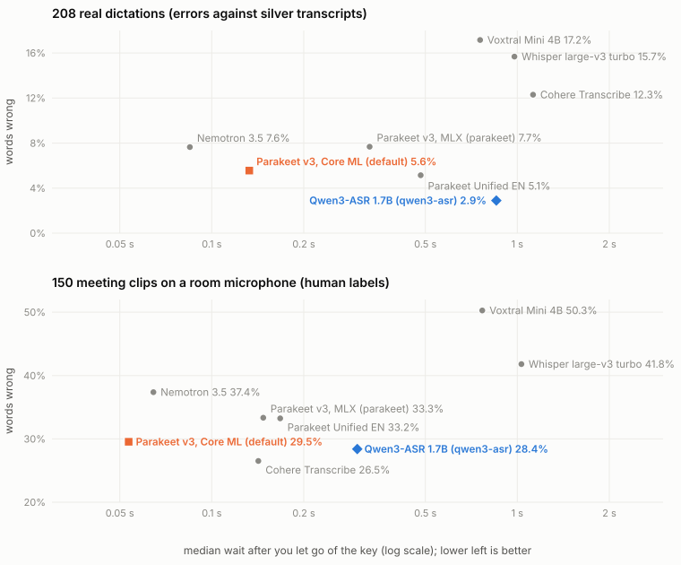

# Benchmarks

Which speech model makes the fewest mistakes, and how long it takes to decode a recording. Each
dot is one model on the maintainers' grid; lower and further left is better.

| Backend | Real dictations | Meetings, room microphone | Meetings, headsets | Earnings calls | Decode after release |
|---|--:|--:|--:|--:|--:|
| `parakeet-coreml` (default) | 5.0% | 29.2% | 8.7% | 7.2% | 0.13 s |
| `qwen3-asr` | 2.4% | 28.2% | 7.7% | 5.9% | 0.85 s |
| `parakeet` (MLX, bf16 on the grid) | 5.4% | 33.3% | 8.9% | 6.1% | 0.25 s |
| `parakeet`, Parakeet Unified EN (bf16) | 4.9% | 32.7% | 7.8% | 6.7% | 0.48 s |

Words wrong, counted the way the [Open ASR Leaderboard](https://huggingface.co/spaces/hf-audio/open_asr_leaderboard)
counts them (its own code), so punctuation, capitals and compounds written apart do not count,
and the two right-hand sets are the leaderboard's own: these columns compare with the AMI and
Earnings22 numbers on model cards. Why the room microphone reads so much higher:
[FAQ](faq.md#why-do-v2ts-error-rates-differ-from-model-cards-and-the-open-asr-leaderboard).

- **Real dictations**: 208 of the maintainer's own, from a few seconds to 12 minutes. They have no
  hand-made transcript, so each is scored against the one that Wispr Flow, Cohere Transcribe and
  Qwen3-ASR (full precision) agree with most, which flatters Qwen3-ASR a little; see
  [Should I switch to Qwen3-ASR?](faq.md#should-i-switch-to-qwen3-asr)
- **Meetings, room microphone**: 150 clips of AMI on a single distant microphone, as a laptop
  hears a meeting, with human labels.
- **Meetings, headsets** and **earnings calls**: the leaderboard's AMI-Cleaned (150 clips, each
  speaker's headset) and Earnings22-Cleaned-AA (six calls, corrected transcripts). With six
  calls the earnings column is only good to 2 or 3 points either way.
- Measured on an M4 Pro in October 2026. The decode time is the grid's, median over the real
  dictations: the whole file under a minute, 30 s pieces decoded while you hold the key from a
  minute up. v2t itself cuts pieces sooner, so it waits less: 0.77 s for `qwen3-asr` measured
  through v2t's own backend. The grid runs MLX Parakeet at bf16; v2t loads it at 8 bits, about
  30% quicker with the same errors to within 0.1 point. The grid and its scripts are in
  [`utils/asr_grid`](https://github.com/lucharo/voice2text/tree/main/utils/asr_grid);
  `plot_models.py` draws this chart.

## On the iPhone

The [iPhone and iPad app](iphone.md) has three parts that can each go wrong on their own: the speech
model, the cleanup, and the keyboard. Each was measured separately, and none of it on an iPad.

### Transcription

On one iPhone 16 Pro, in a separate benchmark app rather than v2t itself (October 2026,
[#85](https://github.com/lucharo/voice2text/issues/85)): 150 clips per set, plugged in, scored the
Open ASR Leaderboard's way. Words wrong, the wait for the text after you stop, and how long the model
took to load the first time:

| Model (who gets it) | LibriSpeech clean | LibriSpeech other | FLEURS Spanish | Wait after you stop (median) | First load |
|---|--:|--:|--:|--:|--:|
| Nemotron-Labs Unified ASR 0.6B, int8 (devices that can run Apple Intelligence) | 1.7% | 3.4% | 3.4% | 105 ms | 18 s |
| Parakeet TDT 0.6B v3 (the rest) | 1.9% | 3.9% | 4.1% | 103 ms | 24 s |

The Parakeet row was measured on the iPhone 16 Pro too; the older iPhones that get it have not been
tested. v2t's own timings on a phone have not been measured, and cleanup adds its time on top.

### Cleanup

Apple Intelligence on the same iPhone 16 Pro, again in the benchmark app, over 600 clips (October
2026, [#67](https://github.com/lucharo/voice2text/issues/67)), cleaning the Parakeet v3 transcripts of
v2t's Mac cleanup benchmark. Cleanup is there for punctuation, so the question is whether it changes
the words you said. Words wrong:

| | LibriSpeech clean | LibriSpeech other | AMI meetings | Earnings calls | Per clip (median) |
|---|--:|--:|--:|--:|--:|
| Transcript before cleanup | 1.9% | 4.2% | 33.3% | 10.8% | |
| Apple Intelligence, as v2t runs it | 1.9% | 4.3% | 34.1% | 10.8% | 1.17 s |
| Apple Intelligence without v2t's guard | 4.0% | 4.8% | 37.6% | 11.2% | 1.17 s |

v2t's guard puts back any word the model dropped or changed, except fillers, repeats, numbers written
as digits and dictionary spellings. Apple Intelligence refused none of the 600. Devices without Apple
Intelligence get no cleanup; no cleanup model for them has been built.

### Keyboard

Apple gives other keyboards none of its swipe or autocorrect engines, so v2t has its own. Their
accuracy so far comes from simulated touches, not fingers:

- **Swiping whole messages** with finger-like traces on the iPhone layout, the right word came first
  98.3% of the time in English and 89.7% in Spanish; with a sloppier finger, 89.6% and 84.6%.
- **Autocorrect** fixed 187 of 200 simulated typos per language and changed none of 1,000 correctly
  typed common words.
- **The typing rules** (capitals, double-space full stop, undoing an autocorrect) are checked by unit tests on the Mac and by UI
  tests that drive the keyboard in the iPhone Simulator.
- **On a real iPhone 17 Pro** (TestFlight build 1), swiping "hey how is it going" typed "GRU how is it
  govt". Build 3 changed the ranking that caused it; that has not been re-measured on a phone.

Keystroke latency and the keyboard's memory have not been measured on a phone. The full table, with
how each number was produced, is in
[ios/README.md](https://github.com/lucharo/voice2text/blob/main/ios/README.md#how-close-it-is-to-apples-keyboard).
