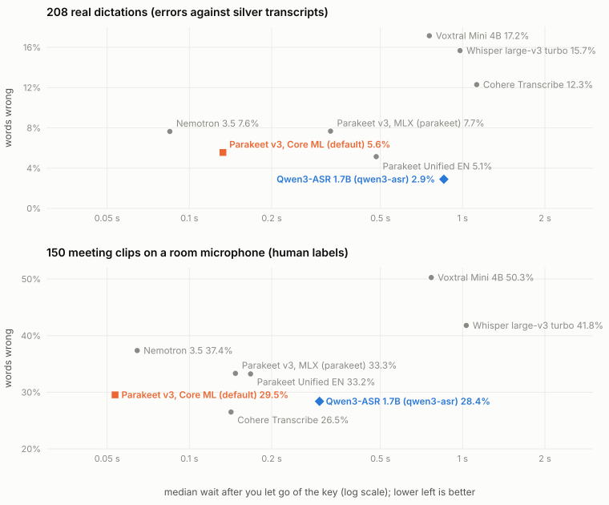

# Benchmarks

Which speech model makes the fewest mistakes, and how long it takes to decode a recording. Each
dot is one model on the maintainers' grid; lower and further left is better.

| Backend | Real dictations | Meetings, room microphone | Phone calls | Decode after release |
|---|--:|--:|--:|--:|
| `parakeet-coreml` (default) | 5.6% | 29.5% | 10.3% | 0.13 s |
| `qwen3-asr` | 2.9% | 28.4% | 8.6% | 0.85 s |
| `parakeet` (MLX, bf16 on the grid) | 5.8% | 33.3% | 10.8% | 0.25 s |
| `parakeet`, Parakeet Unified EN (bf16) | 5.1% | 33.2% | 8.3% | 0.48 s |

Words wrong, after Whisper's text normalisation, so punctuation and capitals do not count. Why
these read higher than model cards and the Open ASR Leaderboard:
[FAQ](faq.md#why-do-v2ts-error-rates-differ-from-model-cards-and-the-open-asr-leaderboard).

- **Real dictations**: 208 of the maintainer's own, from a few seconds to 12 minutes. They have no
  hand-made transcript, so each is scored against the one that Wispr Flow, Cohere Transcribe and
  Qwen3-ASR (full precision) agree with most, which flatters Qwen3-ASR a little; see
  [Should I switch to Qwen3-ASR?](faq.md#should-i-switch-to-qwen3-asr)
- **Meetings** and **phone calls**: 150 clips each from AMI (single distant microphone) and
  Earnings22, with human labels.
- Measured on an M4 Pro in October 2026. The decode time is the grid's, median over the real
  dictations: the whole file under a minute, 30 s pieces decoded while you hold the key from a
  minute up. v2t itself cuts pieces sooner, so it waits less: 0.77 s for `qwen3-asr` measured
  through v2t's own backend. The grid runs MLX Parakeet at bf16; v2t loads it at 8 bits, about
  30% quicker with the same errors to within 0.1 point. The grid and its scripts are in
  [`utils/asr_grid`](https://github.com/lucharo/voice2text/tree/main/utils/asr_grid);
  `plot_models.py` draws this chart.
