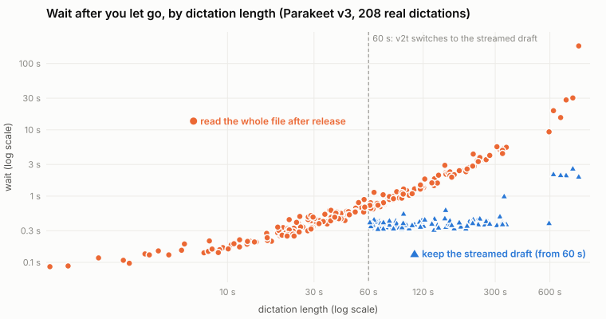

# How it works

## One dictation, start to finish

1. **Record.** The microphone opens when you press the key.
2. **Transcribe.** Parakeet turns the audio into text, on the Neural Engine, while you are still talking.
3. **Clean up.** A small local LLM (`Qwen3.5-2B` by default) adds punctuation and drops the
   "um"s. It may not add or remove content: a chunk whose length drifts too far is pasted raw.
4. **Paste.** The text goes in at your cursor, and your previous clipboard is put back.

Both models stay loaded between dictations, so each one starts at once.

## What happens while you hold the key

- The recording is transcribed in pieces while you keep talking. Each piece ends at the quietest
  moment near its mark, so no word is cut in half. When you let go only the last piece is left:
  a fraction of a second, however long you spoke. On the Neural Engine (the default) a piece is
  12 to 15 seconds, the longest its encoder takes; Qwen3-ASR's are about 30 seconds.
- Parakeet on MLX (`backend = "parakeet"`) transcribes a recording under 60 seconds whole when you
  let go, the most accurate text, and cuts 30-second pieces only from 60 seconds up.
- Every 5 seconds the audio after the last piece is transcribed on its own for the menu bar's
  running count of words. The live transcript on the pill is experimental and off: with
  `live_transcript = true` under `[transcription]` that preview runs every second, so words appear
  about 1 s after you say them. The preview is for display only and never changes the pasted text.
- Experimental: with `preview = "nemotron"` the live words come from a second model made to
  stream, NVIDIA's Nemotron Unified ASR 0.6B, instead: a new stretch every 0.56 s, about 1.1 s
  behind you, at about 50 ms of work each on an M4 Pro. The pasted text still comes from the
  pieces above.

<small>One dot per dictation, Parakeet v3 on an M4 Pro.</small>

Transcribing the whole recording on release would take longer the longer you spoke: 1.3 s at the
median for dictations over a minute, and 9 to 19 s for ones of ten minutes or more. Until 0.5.8
v2t kept a running draft from a Parakeet stream instead. That was quick, but each stretch of audio
was transcribed using only the ~20 seconds before it. On 40 recordings of one to five minutes with
known text, pieces got 2.3% of words wrong against 5.3% for the draft. The stream itself, which
fed the menu bar under 60 seconds, was removed after 0.5.16.

Whisper cannot transcribe in pieces while you talk, so it transcribes the whole recording when you
let go.

## The pill

With the [menu app](getting-started.md#the-menu-app-optional), a small speech bubble sits up and to
the right of the caret while you dictate, its tail curling down-left to just above it, so it covers
neither the caret nor the text beside it. Near the top of the screen it sits down and to the right
instead. It follows the caret: click into another field or move the caret while you dictate and the
bubble moves there within half a second, which is also where the text will be pasted. When the text
is ready, the bubble fades out as it pastes, so the caret moving after the paste never drags it. It
never takes focus, so the paste lands where you are typing.

| State | The pill shows |
|---|---|
| Recording | A waveform of the level v2t is really capturing; a flat line means the microphone is silent |
| Transcribing | A ripple |
| Cleaning up | A pulse, with a seconds counter |

- **Pill** in the menu picks where it sits: **Near text cursor** (the default), **Bottom of
  screen**, or **Off**.
- The tail finds the caret in native text views (TextEdit, Notes, Mail), in Electron apps such as
  Claude and Slack, and in Chrome, Brave, Firefox and Zen, including on an empty line below text; an
  empty field gets the tail at its start. In a tall pane with no caret, such as a Ghostty split, the
  pill sits at the bottom of the pane.
- Apps built on Chromium or Firefox expose their text fields only to an assistive app that asks,
  about 2 s after it asks, so in a freshly opened app the tail can take that long to arrive. Browsers
  are asked through the switch VoiceOver uses, which makes tiling window managers such as Amethyst move
  their windows slowly, so v2t turns it on only while you dictate.
- Each time the pill appears or moves, the log (`~/.v2t/run/v2t.log`) records the app, what it
  reported and where the pill went: positions only, never text.
- After Esc, the cancelled pill shows an **Undo ⌘Z** chip for 5 s. The chip, Cmd+Z or **Undo Cancel** in the menu brings the
  dictation back and carries on recording; after 5 s the audio is dropped and Cmd+Z goes to the app
  as usual.

## Startup

- Parakeet usually loads from the local cache in about 2 s and the cleanup model in about 4 s, so a
  start takes about 6 s; on a busy Mac Parakeet can take up to about 15 s.
- v2t never asks Hugging Face for updates once a model is cached, so a slow or blocked network
  cannot stall startup. Only the first download needs a connection.
