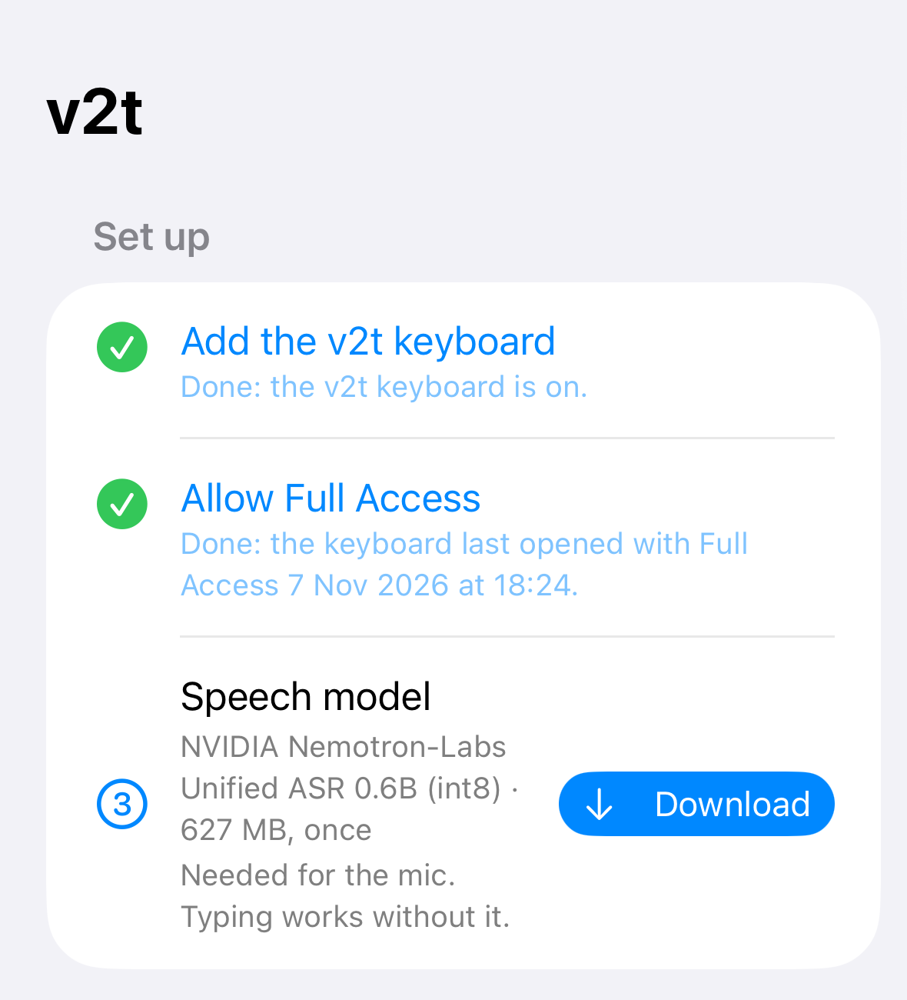
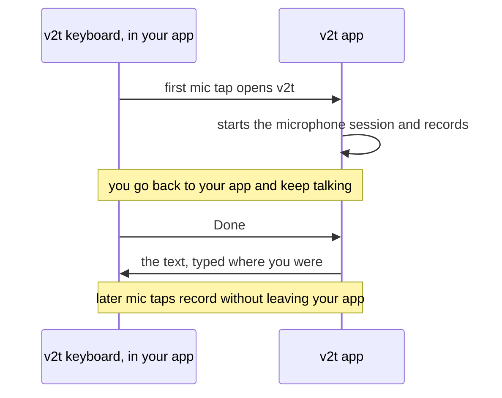
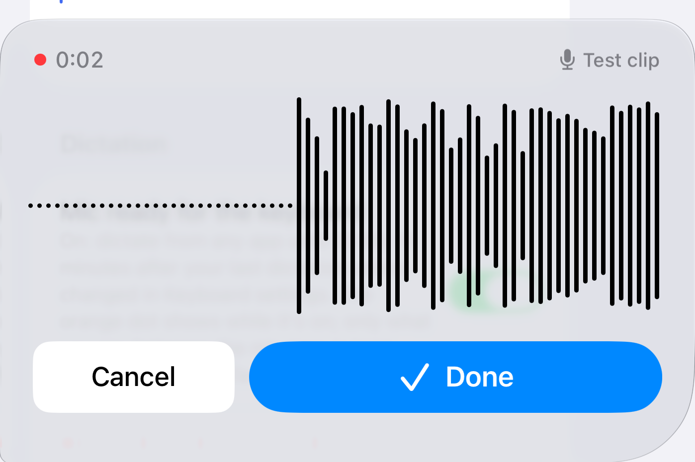
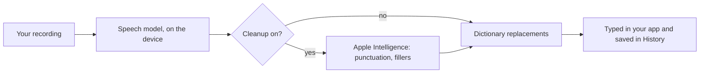

# iPhone and iPad

- A keyboard that types like Apple's, with a v2t mic key: tap it, talk, tap **Done**, and v2t types
  the text where your cursor was.
- v2t transcribes speech on the device, and the audio never leaves it.
- It is test software: so far, only invited testers can install it.

!!! note "Who can install it"

    v2t for iPhone is in internal testing on TestFlight. Only testers the maintainer adds to the app's
    App Store Connect team can install it. It has no public TestFlight link and no App Store listing
    yet. This page describes TestFlight build 3 (5 November 2026). Send problems through TestFlight's
    **Send Beta Feedback** or as a [GitHub issue](https://github.com/lucharo/voice2text/issues).

## Will it work on my device?

- **Installs on:** any iPhone or iPad on iOS 26 or later, which rules out the iPhone XS, XR and
  older. No iPad has been tried.
- **Recommended:** an iPhone that can run Apple Intelligence: the iPhone 15 Pro and Pro Max, the
  iPhone 16 and 17 families, 16e, 17e, Air, Duo, and 18 Pro and Pro Max. These get the more
  accurate speech model and cleanup.
- **Measured so far:** the speech and cleanup models on one iPhone 16 Pro, in a separate benchmark
  app, and the app itself on an iPhone 17 Pro (TestFlight build 1). No result from build
  3, the one described here, has been reported from a phone yet. No other iPhone model has been
  tested. v2t has never run on an iPad, and the project will claim iPad support only once an
  M-series iPad and the iPad mini (A17 Pro) pass an end-to-end test.

The app picks the model for you. It asks iOS whether the device can run Apple Intelligence and makes
one choice:

| This device | Speech model | Cleanup |
| --- | --- | --- |
| Can run Apple Intelligence | NVIDIA Nemotron-Labs Unified ASR 0.6B (627 MB download) | Apple Intelligence, when it is turned on in Settings |
| Cannot (iPhone 15 and 15 Plus, and older) | NVIDIA Parakeet TDT 0.6B v3 (630 MB download) | None, only your dictionary's replacements |

Older phones get Parakeet, which makes a few more mistakes (see
[Benchmarks](benchmarks.md#on-the-iphone)), because the int8 build of Nemotron's sibling model
failed to load on the A16 chip (as in the iPhone 14 Pro and 15)
([FluidAudio #828](https://github.com/FluidInference/FluidAudio/issues/828)). Nemotron itself
has not been tried there. iPads follow the same rule. The app's **This iPhone** (or **This iPad**)
section shows what your device got and why, and says so when your iPhone model is untested.

## Set up

1. Install v2t from TestFlight and open it. It downloads the speech model once, over Wi-Fi or mobile
   data, then shows "Preparing for the Neural Engine…" and finally **Ready**. From then on,
   transcription works offline.
2. Tap **Add the v2t keyboard**. It opens Settings: go to **v2t** › **Keyboards** and turn on
   **v2t**. (General › Keyboard › Keyboards › Add New Keyboard does the same.)
3. On the same page, turn on **Allow Full Access** and confirm. The keyboard needs Full Access to ask
   the app to record; without it, the mic key does nothing. Nothing you type leaves the device.
4. Back in v2t, tap the **Try it** field and switch to the v2t keyboard with the globe key. iOS does not
   tell an app whether its keyboard is on, so the app's checklist ticks its first two rows only once
   the v2t keyboard has opened with Full Access.
5. Turn on **Mic ready for the keyboard**, and allow the microphone when iOS asks. The microphone
   session is now on, so your first dictation records without the trip to the app described below.

<figure markdown>
  { width="320" }
  <figcaption>Setup done. Simulator screenshot, build 3.</figcaption>
</figure>

## Dictate

Tap the v2t mic key (on the iPhone, to the left of return).

When no microphone session is on, the v2t app itself opens, because iOS gives keyboards no
microphone. It is already listening: go back to your app (tap ◀ at the top left, or swipe right
along the bottom edge) and keep talking. iOS gives v2t no way to send you back. From then on the
microphone session stays on, and the mic key records without leaving your app.

While you talk, a waveform and a timer cover the keys. Tap **Done** to finish: transcription starts
then, and the keyboard shows "Transcribing…" before it types the text. **Cancel** stops without
typing anything, though v2t still saves the dictation in History.

<figure markdown>
  { width="320" }
  <figcaption>Recording. Simulator screenshot, build 3.</figcaption>
</figure>

### The microphone session

- iOS shows the orange microphone dot while the session is on. v2t keeps only what you say between
  tapping the mic and tapping Done or Cancel; it records and saves nothing else.
- The session turns off 15 minutes after your last dictation. Change that under **Languages and
  typing** › **Keep the mic ready for**: 5 minutes, 15 minutes, 1 hour, or until you turn it off
  yourself, as below.
- To turn it off now, open v2t and tap **Stop microphone session**, or turn off **Mic ready for the
  keyboard**. The next mic tap opens v2t again.

### What happens to your words

- **Cleanup** runs only on a device that can run Apple Intelligence, with Apple Intelligence turned
  on. It adds punctuation and capitals, drops "um" and repeated words, writes numbers as digits and
  uses your dictionary's spellings. Any other word it changes reverts to what you said. Cleanup adds
  about a second. Turn it off with **Clean up with Apple Intelligence**; the switch is greyed out
  when Apple Intelligence is off or not ready.
- **Dictionary** has two lists. **Spell exactly** holds names and jargon: cleanup spells them as
  written, and the keyboard never autocorrects them. **Replace** turns what v2t heard into what you
  want written (whole words, any capitalisation); it runs after cleanup, whether cleanup is on or
  off. The file format is the Mac app's, so you can paste your Mac dictionary into **Edit as text**.
- **History** lists your dictations on this device, newest first. A **Heard:** line shows the words
  before cleanup and replacements changed them. Touch and hold an entry to copy it; swipe left to
  delete.
- **Speech language**: English, Español, or Detect.

## Typing

The keyboard does its own swiping, autocorrection and word suggestions, because iOS withholds
Apple's from other keyboards. It has English (QWERTY) and Spanish (with ñ) layouts, suggests English
and Spanish together unless you turn that off, offers accents on a long press, and moves the cursor
when you hold the space bar and slide. Their settings are under **Languages and typing** in the app.

iOS limits every third-party keyboard, v2t's included:

- No text selection, edit menu or system undo. The space-bar cursor moves only left and right.
- Apple's keyboard takes over in password and phone-number fields, and in apps that refuse other
  keyboards.
- Key previews on the top row draw over the suggestion bar, not above the keyboard.
- A keyboard cannot use the microphone or open its own app on request, so the first dictation of a
  session goes through the v2t app.

## Troubleshooting

**The mic key does nothing.** Full Access is off. Turn it on in Settings › v2t › Keyboards › Allow
Full Access.

**Tapping the mic opens the v2t app.** It does that whenever no microphone session is on: on the
first dictation, after the session times out, or after you close v2t from the app switcher. v2t is
already listening; go back to your app and keep talking.

**The text never appeared.** v2t types the text once, into the field where you tapped Done. You can
go to the v2t app and back before then. If you left the field before the text arrived, or tapped
Cancel, find the text in the app's **History**.

**The orange dot stays on.** The microphone session is waiting for your next dictation. Open v2t and
tap **Stop microphone session**.

**The speech model shows an error.** The first download needs a network connection. Tap **Try
again** once you're online.

**Clean up with Apple Intelligence is greyed out.** Apple Intelligence is off, still downloading, or
unavailable on this device. Turn it on in Settings › Apple Intelligence & Siri, then reopen v2t.
Until then you get the words as heard, plus your replacements.

**Apple's keyboard appears instead of v2t's.** iOS does that in password and phone-number fields and
in apps that refuse other keyboards. v2t cannot change it.

## How well it works

Each part was measured separately, and the gaps are listed too. Details and sources:
[Benchmarks on the iPhone](benchmarks.md#on-the-iphone).

- **Transcription:** speech models timed and scored on one iPhone 16 Pro, in a benchmark app.
- **Cleanup:** Apple Intelligence scored on the same iPhone 16 Pro, also in a benchmark app.
- **Keyboard:** swipe and autocorrect accuracy comes from simulated touches, and the typing rules
  from tests in the iPhone Simulator. Nobody has measured accuracy with real fingers, or anything on
  an iPad.

## Build it yourself

To build, test and sign the app, see
[ios/README.md](https://github.com/lucharo/voice2text/blob/main/ios/README.md).
