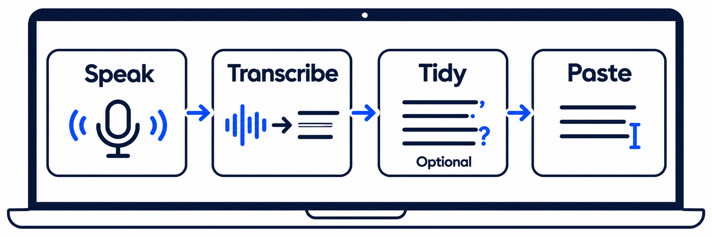

# How it works

The default Mac pipeline uses **Parakeet v3 on the Neural Engine** for transcription and **Qwen3.5-0.8B through MLX** for cleanup. Both run on your Mac.

For long dictations, v2t transcribes audio in pieces while you speak. When you release the key, it finishes the remaining audio, runs cleanup and pastes the result at your cursor.

Cleanup is optional. Casual mode limits changes to the words; strict mode allows more rewriting. Neither guarantees an error-free transcript.

Experimental live words in the dictation bubble are a preview. They do not replace the final transcription.

[Change the defaults](reference/config.md) · [See measured results](benchmarks.md)

---
<!-- doc-audit:last-reviewed -->
_Last reviewed: 2026-11-05 · commit `4d5dcb4` · verified against code._
