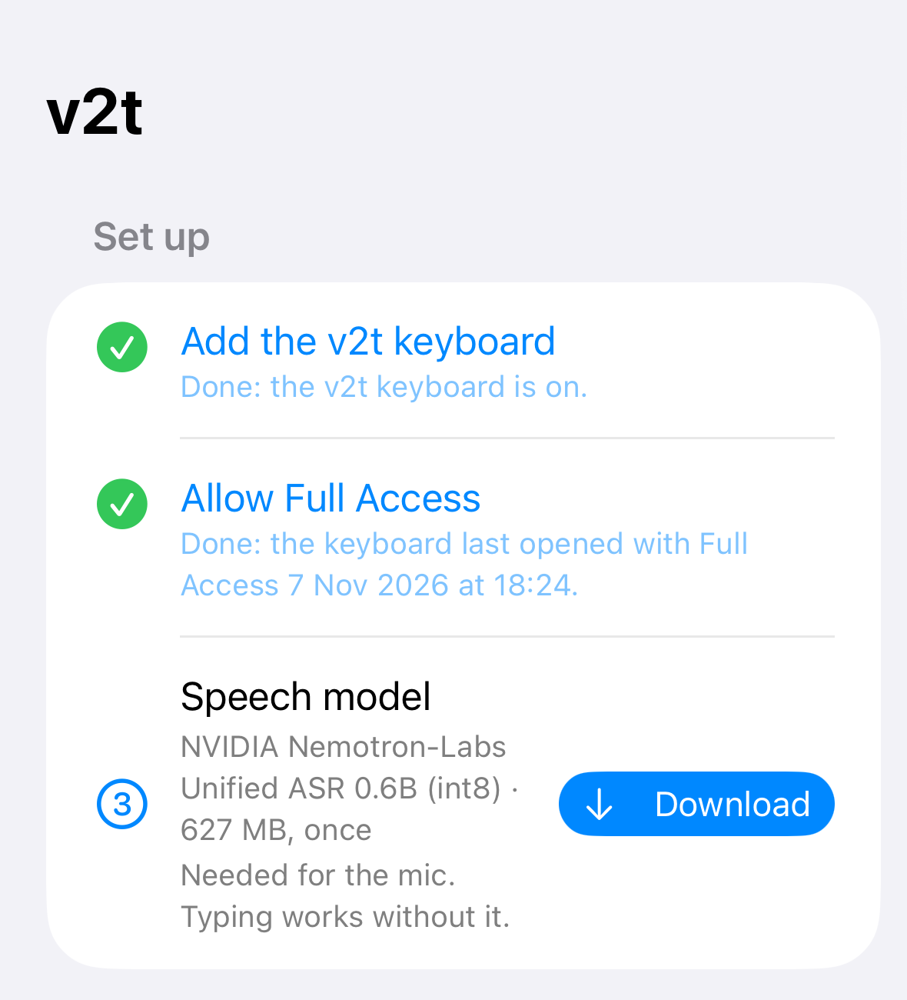
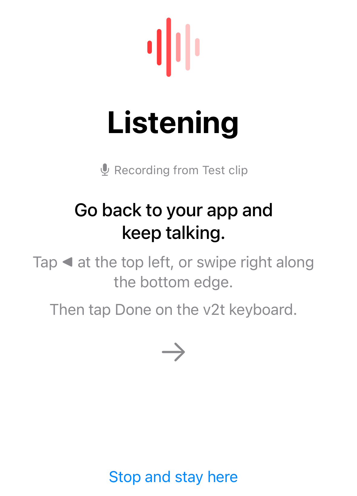
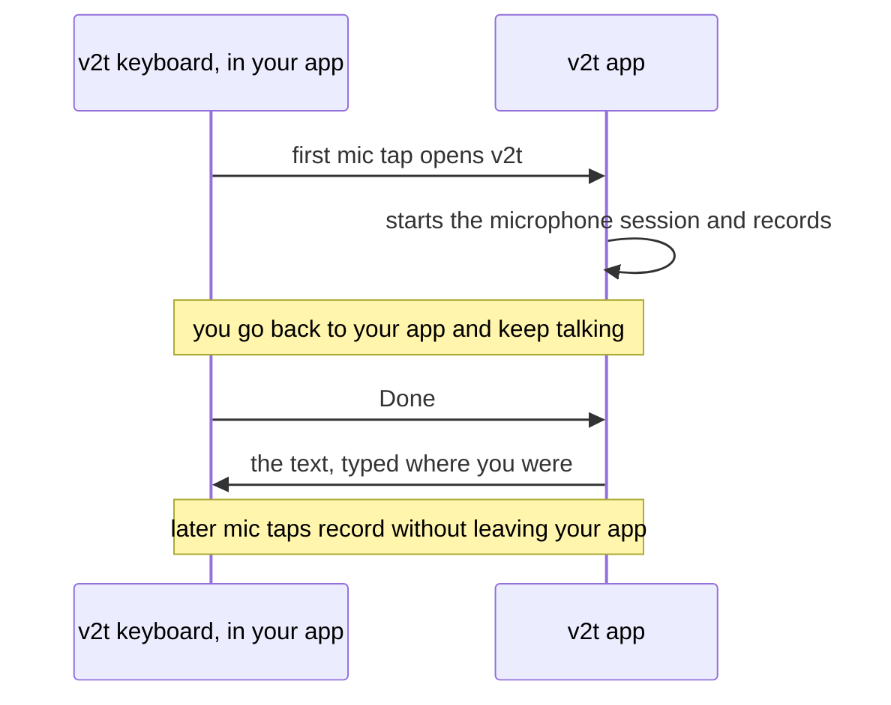
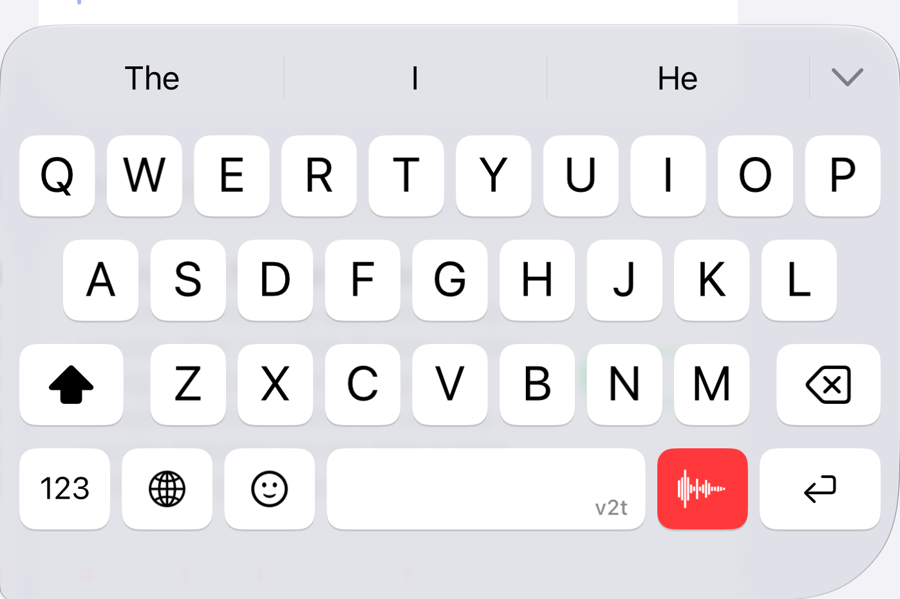
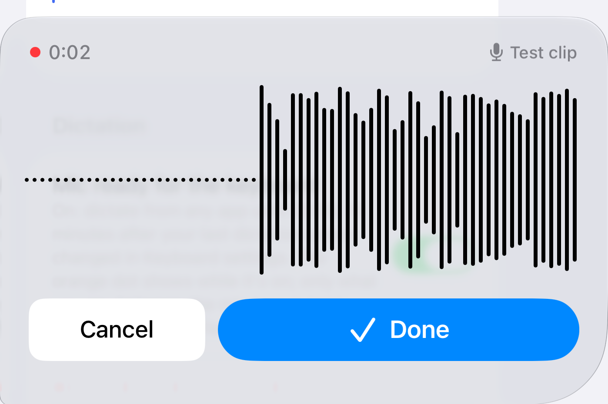
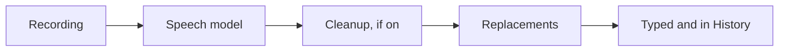
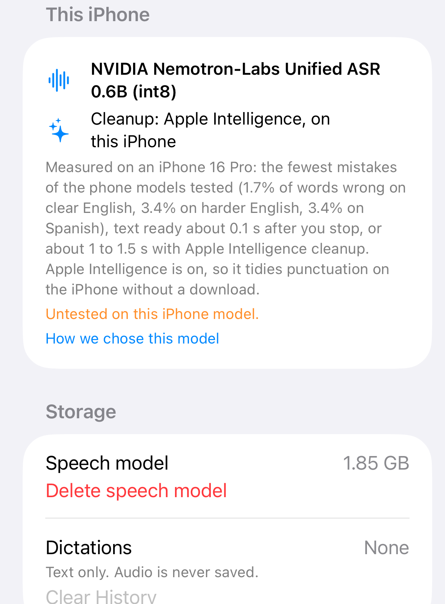
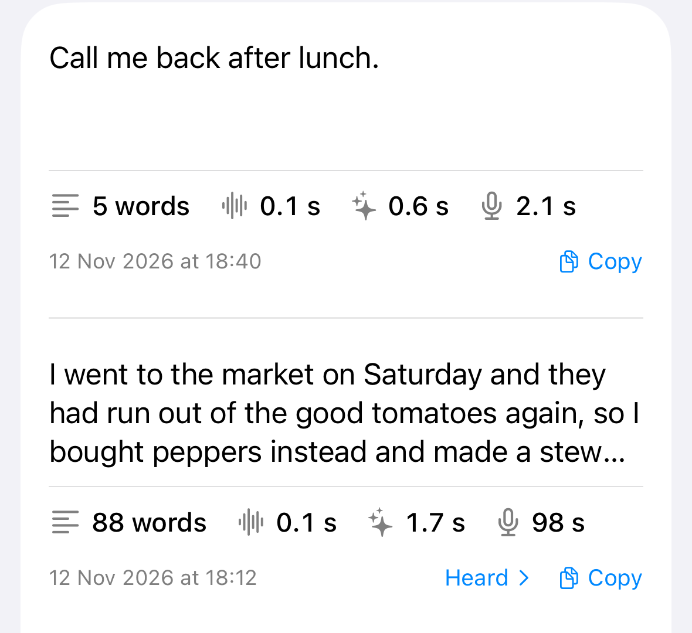
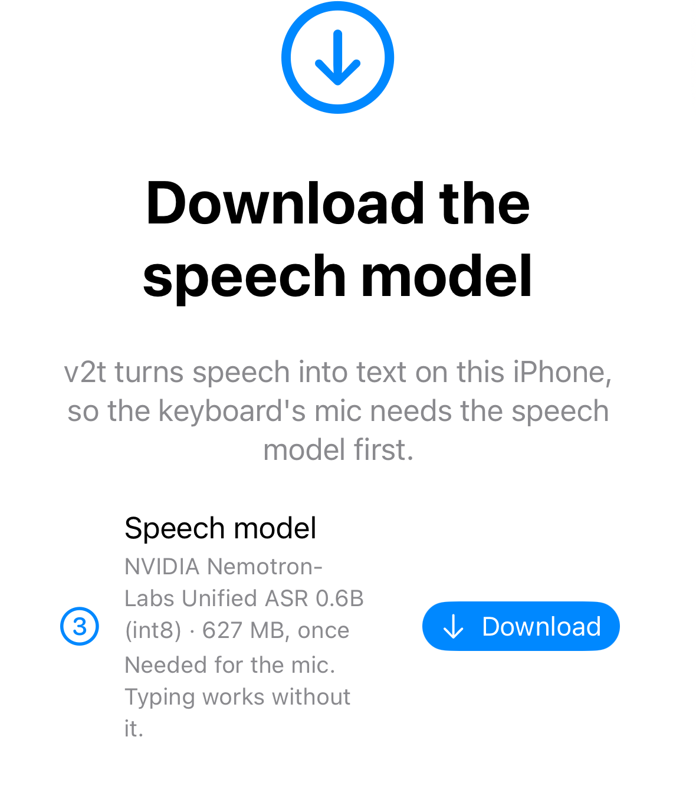

# iPhone and iPad

- A keyboard that types like Apple's, with a v2t mic key: tap it, talk, tap **Done**, and v2t types
  the text where your cursor was.
- v2t transcribes speech on the device, and the audio never leaves it.
- It is free on the [App Store](https://apps.apple.com/app/id6831059370).

!!! note "Where to get it"

    Install v2t from the [App Store](https://apps.apple.com/app/id6831059370). Every change goes to TestFlight first, for the testers
    the maintainer invites, and reaches the App Store in a later release. This page describes the app
    as of 6 November 2026. Send problems as a
    [GitHub issue](https://github.com/lucharo/voice2text/issues), or through TestFlight's
    **Send Beta Feedback** if you test it there.

## Will it work on my device?

- **Installs on:** any iPhone or iPad on iOS 26 or later, which rules out the iPhone XS, XR and
  older. No iPad has been tried.
- **Recommended:** an iPhone that can run Apple Intelligence: the iPhone 15 Pro and Pro Max, the
  iPhone 16 and 17 families, 16e, 17e, Air, Duo, and 18 Pro and Pro Max. These get the more
  accurate speech model and cleanup.
- **Transcription only, untested:** the iPhone 13 and 14 families, iPhone 15 and 15 Plus, and iPhone
  SE (3rd generation). Dictation works, without cleanup, but no one has tested it on these phones;
  the app says "Not yet tested on this iPhone model".
- **Dictation not supported yet:** the iPhone 11, 11 Pro and 11 Pro Max, iPhone SE (2nd generation),
  and the iPhone 12, 12 mini, 12 Pro and 12 Pro Max. These phones have not passed a test run. The app
  offers no model download and says "Dictation isn't supported on this iPhone yet. The keyboard still
  works for typing."; the keyboard's mic opens that message. The same goes for the iPad mini (5th
  generation), iPad Air (3rd and 4th generation), iPad (8th, 9th and 10th generation), iPad Pro 11-inch
  (1st and 2nd generation) and iPad Pro 12.9-inch (3rd and 4th generation).
- **Measured so far:** the speech and cleanup models on one iPhone 16 Pro, in a separate benchmark
  app, and the app itself on an iPhone 17 Pro (TestFlight build 1). No result from build
  3, the one described here, has been reported from a phone yet. No other iPhone model has been
  tested. v2t has never run on an iPad, and the project will claim iPad support only once an
  M-series iPad and the iPad mini (A17 Pro) pass an end-to-end test.

The app picks the model for you. It asks iOS whether the device can run Apple Intelligence and makes
one choice:

| This device | Speech model | Cleanup |
| --- | --- | --- |
| Can run Apple Intelligence | NVIDIA Nemotron-Labs Unified ASR 0.6B (627 MB download) | Apple Intelligence, when it is turned on in Settings |
| Cannot (iPhone 15 and 15 Plus, the iPhone 13 and 14 families, SE 3rd generation) | NVIDIA Parakeet TDT 0.6B v3 (630 MB download) | None, only your dictionary's replacements |
| iPhone 11 and 12 families, SE 2nd generation | None: dictation is not supported yet | None |

Older phones get Parakeet, which makes a few more mistakes (see
[Benchmarks](benchmarks.md#on-the-iphone)), because the int8 build of Nemotron's sibling model
failed to load on the A16 chip (as in the iPhone 14 Pro and 15)
([FluidAudio #828](https://github.com/FluidInference/FluidAudio/issues/828)). Nemotron itself
has not been tried there. iPads follow the same rule. The app's **This iPhone** (or **This iPad**)
section shows what your device got and why, says so when your iPhone model is untested, and links to
**How we chose this model**.

## Set up

1. Install v2t from the [App Store](https://apps.apple.com/app/id6831059370), open it and tap **Download** next to **Speech model** (about 630 MB,
   once). The mic needs it; typing doesn't. When the row says **Ready**, transcription works offline.
2. Tap **Add the v2t keyboard**. It opens Settings: go to **v2t** › **Keyboards** and turn on
   **v2t**. (General › Keyboard › Keyboards › Add New Keyboard does the same.)
3. On the same page, turn on **Allow Full Access** and confirm. The keyboard needs Full Access to ask
   the app to record; without it, the mic key does nothing. Nothing you type leaves the device.
4. Back in v2t, tap the **Try it** field and switch to the v2t keyboard with the globe key. iOS does not
   tell an app whether its keyboard is on, so the app's checklist ticks its first two rows only once
   the v2t keyboard has opened with Full Access.
5. Turn on **Mic ready for the keyboard**, and allow the microphone when iOS asks. The microphone
   session is now on, so your first dictation records without the trip to the app described below.

<figure markdown>
  { width="340" }
  <figcaption>The keyboard is set up; the speech model still needs its download. All screenshots on this page come from the iPhone Simulator, 6 November 2026.</figcaption>
</figure>

## Dictate

Tap the red v2t mic key (on the iPhone, to the left of return).

When no microphone session is on, the v2t app itself opens, because iOS gives keyboards no
microphone. It is already listening: go back to your app (tap ◀ at the top left, or swipe right
along the bottom edge) and keep talking. iOS gives v2t no way to send you back. From then on the
microphone session stays on, and the mic key records without leaving your app.

<figure markdown>
  { width="300" }
  <figcaption>What the first mic tap of a session opens. On a phone it names the real microphone.</figcaption>
</figure>

While you talk, a waveform, a timer and the name of the microphone in use cover the keys. Tap
**Done** to finish: the keyboard shows "Transcribing…", then "Cleaning up…" if cleanup is on, then
types the text. A dictation over about
15 seconds is transcribed in pieces while you talk, so only the last piece is left after Done.
**Cancel** stops without typing anything, though v2t still saves the dictation in History. Cancel
stays on screen while v2t transcribes or cleans up; tapping it then stops that work, and v2t keeps
nothing of the dictation.

<figure markdown>
  { width="320" }
  <figcaption>The red mic key, left of return. The Simulator draws no iOS globe below the keys, so v2t shows its own here.</figcaption>
</figure>
<figure markdown>
  { width="320" }
  <figcaption>Recording: Cancel or Done. "Test clip" is the Simulator's stand-in for a microphone.</figcaption>
</figure>

### The microphone session

- iOS shows the orange microphone dot while the session is on. v2t keeps only what you say between
  tapping the mic and tapping Done or Cancel; it records and saves nothing else.
- **Microphone**, under the mic switch, picks where v2t records from. **This iPhone** (the default)
  uses the phone's own microphone even with AirPods connected, so music in other apps keeps playing
  as it would without v2t. **Connected headset** uses AirPods or a wired headset; with AirPods, music
  drops to call quality while the session is on. The app and the recording view show the
  microphone's name. None of this has been checked on a phone yet.
- The session turns off 15 minutes after your last dictation. Change that under **Languages and
  typing** › **Keep the mic ready for**: 5 minutes, 15 minutes, 1 hour, or until you turn it off
  yourself, as below. A dictation still being transcribed by then is stopped with it.
- To turn it off now, open v2t and tap **Stop microphone session**, or turn off **Mic ready for the
  keyboard**. This also stops a dictation still being transcribed, which is then lost. The next mic
  tap opens v2t again.

### What happens to your words

- **Cleanup** runs only on a device that can run Apple Intelligence, with Apple Intelligence turned
  on. It adds punctuation and capitals, drops "um" and repeated words, writes numbers as digits and
  uses your dictionary's spellings. Any other word it changes reverts to what you said. Cleanup adds
  about a second. Turn it off with **Clean up with Apple Intelligence**; the switch is greyed out
  when Apple Intelligence is off or not ready, or when the device can't run it.
- **Dictionary** has two lists. **Spell exactly** holds names and jargon: cleanup spells them as
  written, and the keyboard never autocorrects them. **Replace** turns what v2t heard into what you
  want written (whole words, any capitalisation); it runs after cleanup, whether cleanup is on or
  off. The file format is the Mac app's, so you can paste your Mac dictionary into **Edit as text**.
- **History** lists your dictations on this device, newest first. A **Heard:** line shows the words
  before cleanup and replacements changed them. Touch and hold an entry to copy it; swipe left to
  delete. Each entry also keeps how long the dictation took; the stopwatch menu copies those timings
  and opens **Compare cleanup**.
- **Speech language**: English, Español, or Detect.
- **Storage** shows the space the speech model and your dictations take, with **Delete speech
  model** and **Clear History**. Audio is never saved; History keeps text only.

<figure markdown>
  { width="340" }
  <figcaption>The device card and Storage (Clear History sits just below). Sizes are the Simulator's; a phone's may differ.</figcaption>
</figure>

<figure markdown>
  { width="340" }
  <figcaption>A dictation in History. A replacement (simulator becomes iPhone Simulator) changed it, so the Heard line shows the original.</figcaption>
</figure>

## Typing

The keyboard does its own swiping, autocorrection and word suggestions, because iOS withholds
Apple's from other keyboards. It has English (QWERTY) and Spanish (with ñ) layouts, suggests English
and Spanish together unless you turn that off, offers accents on a long press, and moves the cursor
when you hold the space bar and slide. Their settings are under **Languages and typing** in the app.

- **Emoji:** on Face ID iPhones the emoji key sits after 123, where Apple's keyboard has it, and
  opens v2t's emoji panel; long-press an emoji for skin tones and tap **ABC** to go back. iOS's own
  globe below the keys switches keyboards. Where iOS draws no globe (iPads, Touch ID iPhones), v2t
  shows its own globe with the emoji key after it. The panel has a **Search Emoji** field, and while
  you type, the suggestion bar's last slot offers the word's emoji (🍕 after "pizza").
- **Words you keep:** when autocorrect changes a word and you take yours back (delete, then tap it
  in the bar), v2t adds it to your dictionary if no word list knows it. Autocorrect then leaves it
  alone, and cleanup spells it too. Delete a typo kept by mistake in **Dictionary**.
- **Hide the keyboard** with the chevron at the right end of the suggestion bar (on the iPad, the
  hide key in the bottom row).
- **Keyboard debug log:** off unless you turn it on, under **Languages and typing** › Debugging.
  While it is on, a small red dot shows at the left of the suggestion bar and the keyboard records
  what you type with it (keys, swipes, suggestions, corrections, and the words themselves) to a file
  on your iPhone, so the keyboard's mistakes can be studied. Dictation is recorded by length only.
  Nothing leaves the iPhone unless you tap **Export**, and **Clear log** deletes it. It turns itself
  off after 24 hours, and never records in password, one-time-code or card fields. It needs Full
  Access, like dictation.

iOS limits every third-party keyboard, v2t's included:

- No text selection, edit menu or system undo. The space-bar cursor moves only left and right.
- Apple's keyboard takes over in password and phone-number fields, and in apps that refuse other
  keyboards.
- Key previews on the top row draw over the suggestion bar, not above the keyboard.
- A keyboard cannot use the microphone or open its own app on request, so the first dictation of a
  session goes through the v2t app.
- A keyboard never sees taps outside itself, so it cannot hide when you tap away; the app you type
  in decides that. Use the chevron.
- The globe and microphone below the keys on Face ID iPhones belong to iOS. v2t asks iOS to
  disable that microphone, since its own mic key dictates. Whether iOS then hides it or only greys
  it out has not been checked on a phone. If it still shows, Settings › General › Keyboard ›
  **Enable Dictation** off removes it, for Apple's keyboard too.

## Troubleshooting

**The mic key does nothing.** Full Access is off. Turn it on in Settings › v2t › Keyboards › Allow
Full Access.

**Tapping the mic opens the v2t app.** It does that whenever no microphone session is on: on the
first dictation, after the session times out, or after you close v2t from the app switcher. v2t is
already listening; go back to your app and keep talking.

**The text never appeared.** v2t types the text once, into the field where you tapped Done. You can
go to the v2t app and back before then. If you left the field before the text arrived, or tapped
Cancel while recording, find the text in the app's **History**. Cancel after Done keeps nothing.

**The orange dot stays on.** The microphone session is waiting for your next dictation. Open v2t and
tap **Stop microphone session**.

**Tapping the mic opens v2t on "Download the speech model".** The model isn't on this device yet,
or was deleted. Tap **Download**, then go back to your app and tap the mic again.

<figure markdown>
  { width="300" }
  <figcaption>What the mic opens when the speech model isn't on the device.</figcaption>
</figure>

**Tapping the mic opens v2t on "Preparing the speech model".** The first time the model loads after
its download, v2t prepares it for this device, and the mic waits until that is done. Stay in v2t
until it says the model is ready, then go back to your app and tap the mic again.

**The speech model shows an error, or "The speech model didn't load".** The download needs a network
connection. Tap **Try again** once you're online.

**Clean up with Apple Intelligence is greyed out.** If it says this device can't run Apple
Intelligence, cleanup will never be available on it: you get the words as heard, plus your
replacements. Otherwise Apple Intelligence is off or still downloading. Turn it on in Settings ›
Apple Intelligence & Siri, then reopen v2t. Until then you get the words as heard, plus your
replacements.

**Apple's keyboard appears instead of v2t's.** iOS does that in password and phone-number fields and
in apps that refuse other keyboards. v2t cannot change it.

## How well it works

Each part was measured separately, and the gaps are listed too. Details and sources:
[Benchmarks on the iPhone](benchmarks.md#on-the-iphone).

- **Transcription:** speech models timed and scored on one iPhone 16 Pro, in a benchmark app.
- **Cleanup:** Apple Intelligence scored on the same iPhone 16 Pro, also in a benchmark app.
- **Keyboard:** swipe accuracy comes from simulated touches, autocorrect from checks against Apple's
  keyboard and lists of real misspellings, and the typing rules from tests in the iPhone Simulator.
  Nobody has measured accuracy with real fingers, or anything on an iPad.

## Build it yourself

To build, test and sign the app, see
[ios/README.md](https://github.com/lucharo/voice2text/blob/main/ios/README.md).
